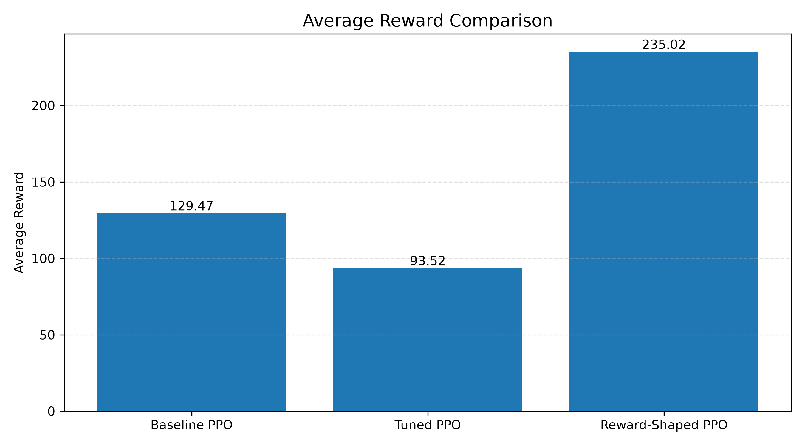
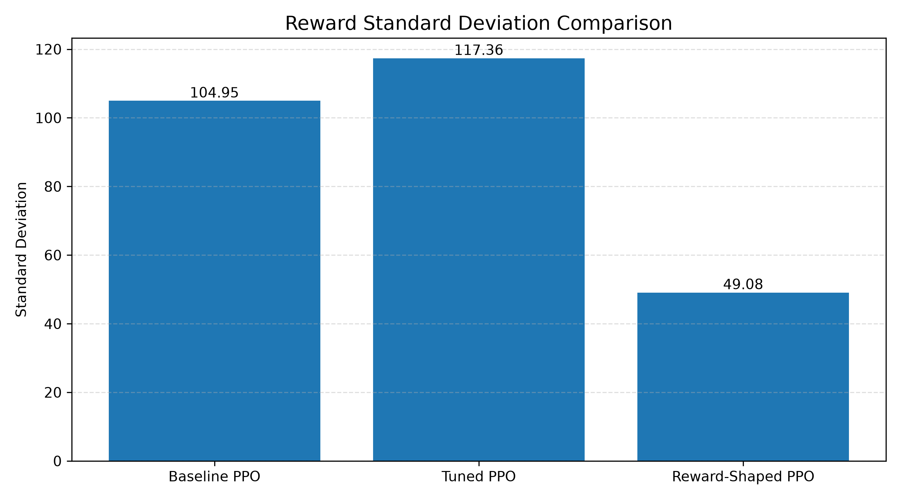
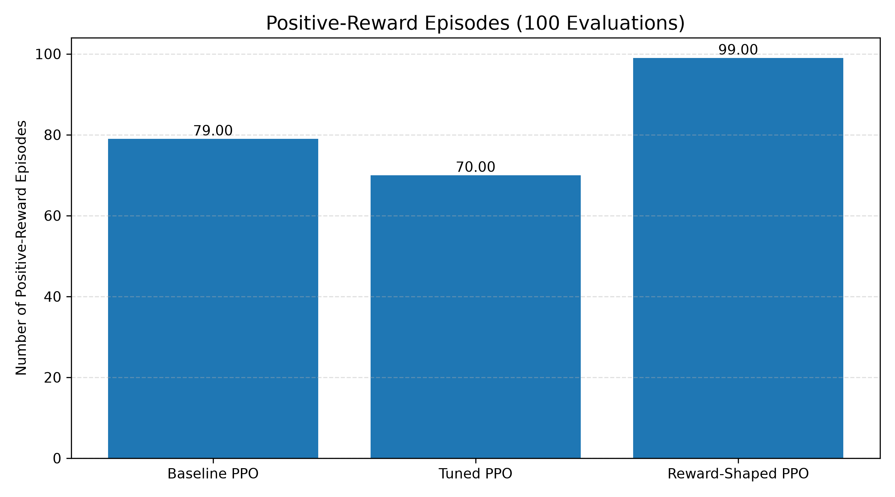

# LunarLander AI: Reinforcement Learning with PPO

An autonomous lunar lander trained using **Proximal Policy Optimization (PPO)**, with experiments in hyperparameter optimization and potential-based reward shaping.

The project uses Gymnasium's `LunarLander-v3` environment and Stable-Baselines3 to train and evaluate reinforcement learning agents.

## Project Overview

The objective is to train an AI agent that learns to control a lunar lander and achieve safe, consistent landings through interaction with a simulated environment.

Three approaches were implemented and compared:

1. **Baseline PPO:** A standard PPO agent trained with manually selected hyperparameters.
2. **Tuned PPO:** A PPO agent trained using hyperparameters selected through Optuna.
3. **Reward-Shaped PPO:** A PPO agent trained with an additional potential-based reward signal to encourage desirable landing behaviour.

## Experimental Results

All models were evaluated over 100 episodes using identical seeds (1000–1099) and the original, unmodified LunarLander-v3 environment.

| Metric | Baseline PPO | Tuned PPO | Reward-Shaped PPO |
|---|---:|---:|---:|
| Average Reward | 129.47 | 93.52 | **235.02** |
| Standard Deviation | 104.95 | 117.36 | **49.08** |
| Best Reward | 236.66 | 218.24 | **301.62** |
| Worst Reward | -100.07 | -144.02 | **-4.50** |
| Positive-Reward Episodes | 79/100 | 70/100 | **99/100** |


## Performance Visualizations

### Average Reward


### Reward Standard Deviation


### Positive-Reward Episodes



### Key Findings

- Reward shaping improved average evaluation reward by approximately **81.5%** compared with baseline PPO.
- The reward-shaped model had approximately **53.2% lower reward standard deviation** than the baseline.
- The reward-shaped model achieved positive rewards in 99 out of 100 evaluation episodes.
- The initial Optuna hyperparameter search did not outperform baseline PPO.

These results indicate that reward shaping substantially improved the observed performance and consistency of the agent in this experiment.

## Technologies Used

- Python
- Gymnasium
- Stable-Baselines3
- PyTorch
- Optuna
- NumPy
- Matplotlib

## Project Structure

```text
Lunar-Render-RL/
│
├── src/
│   ├── random_agent.py
│   ├── environment_info.py
│   ├── train.py
│   ├── evaluate.py
│   ├── tune_ppo.py
│   ├── train_tuned.py
│   ├── compare_models.py
│   ├── reward_shaping.py
│   ├── test_reward_shaping.py
│   ├── train_shaped.py
│   └── evaluate_shaped.py
│
├── models/
│   ├── ppo_lunar_lander.zip
│   ├── ppo_lunar_lander_tuned.zip
│   └── ppo_lunar_lander_shaped.zip
│
├── experiments/
│   ├── ppo_tuning.db
│   └── results.md
│
├── videos/
├── notebooks/
├── .gitignore
├── README.md
└── requirements.txt
```

## Installation

Clone the repository:

```bash
git clone https://github.com/Apil-Maraseni/Lunar-Lander-RL.git
```

Navigate to the project directory:

```bash
cd Lunar-Render-RL
```

Create a virtual environment:

```bash
python -m venv .venv
```

Activate it:

**Windows:**

```powershell
.venv\Scripts\activate
```

Install dependencies:

```bash
pip install -r requirements.txt
```

Gymnasium's Box2D dependencies may require additional system packages depending on your operating system.

## Running the Project

Run the random agent:

```bash
python src/random_agent.py
```

Inspect the environment:

```bash
python src/environment_info.py
```

Train the baseline PPO model:

```bash
python src/train.py
```

Evaluate the baseline:

```bash
python src/evaluate.py
```

Run hyperparameter optimization:

```bash
python src/tune_ppo.py
```

Train the tuned model:

```bash
python src/train_tuned.py
```

Train the reward-shaped model:

```bash
python src/train_shaped.py
```

Compare all three trained models:

```bash
python src/compare_models.py
```

## Reward Shaping

The project implements potential-based reward shaping using:

\[
F(s,s') = \gamma\Phi(s')-\Phi(s)
\]

The shaping reward is added to the original environment reward during training.

The potential function considers the lander's position, velocity, and orientation to provide additional feedback about desirable state transitions.

For the implementation and detailed experimental analysis, see [`experiments/results.md`](experiments/results.md).

## Future Improvements

- Experiment with alternative potential functions and shaping weights.
- Perform repeated training runs with different random seeds.
- Investigate additional PPO hyperparameter configurations.
- Measure actual landing success using terminal states and landing conditions.
- Visualize and compare agent landing trajectories.
- Explore additional reinforcement learning algorithms.

## Author

**Apil Maraseni**

Computer Engineering Student

[GitHub Profile](https://github.com/Apil-Maraseni)

---

*This project was developed as a practical exploration of reinforcement learning, PPO, hyperparameter optimization, and reward shaping.*
